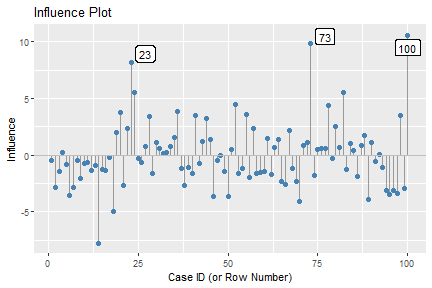
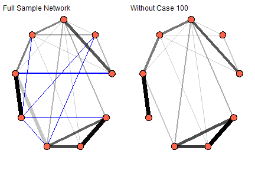
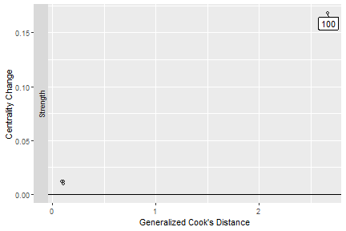
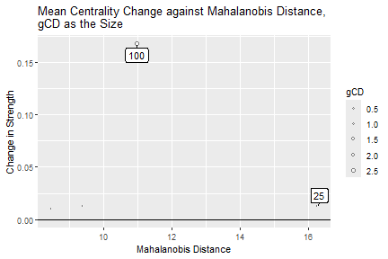

# netinf-quickstart

## Quick Start

`netinf` identifies **influential cases** in psychological network
analysis. It reuses the same bootstrap samples of `bootnet` for
influence diagnostics.

For the theory and formulas behind each step, see the [Detailed
Guide](https://yangborui859-maker.github.io/netinf/articles/netinf-detailedguide.md).

### Setup

``` r

library(netinf)
```

### The data

The package ships with a simulated dataset `test_data`: 100 cases × 9
variables. The last case (row 100) is an artificially constructed
influential case.

``` r

data("test_data", package = "netinf")
```

### The all-in-one function

For most users,
[`influence_diagnostic()`](https://yangborui859-maker.github.io/netinf/reference/influence_diagnostic.md)
runs the whole workflow in one call:

``` r

diag <- influence_diagnostic(
  data               = test_data,
  nBoots             = 5000,
  centrality_metrics = c("Strength", "Closeness", "Betweenness"), # Select the statistics to calculate the generalized Cook distance.
  default            = "EBICglasso",
  verbose            = FALSE
)
```

The output contains three parts:

- **Phase 1**: empirical influence values per case
- **Phase 2**: leave-one-out validation of selected candidates
- **Phase 3**: centrality gCD (generalized Cook’s distance)

### Manual workflow

If you want to run each step yourself, the four functions form a
pipeline.

#### Step 1: bootstrap with case indices

[`bootnet_with_indices()`](https://yangborui859-maker.github.io/netinf/reference/bootnet_with_indices.md)
runs
[`bootnet::bootnet()`](https://rdrr.io/pkg/bootnet/man/bootnet.html) and
additionally stores the case index drawn in each bootstrap sample.

``` r

set.seed(1)
boot_res <- bootnet_with_indices(
  test_data,
  nBoots  = 5000,
  default = "EBICglasso",
  verbose = FALSE
)
#> Note: bootnet will store only the following statistics:  edge, strength, outStrength, inStrength
#> Note: Network with lowest lambda selected as best network: assumption of sparsity might be violated.
```

#### Step 2: empirical influence per case

[`calculate_empirical_influence()`](https://yangborui859-maker.github.io/netinf/reference/calculate_empirical_influence.md)
turns the bootstrap indices into a numeric influence value per case.

``` r

empic <- calculate_empirical_influence(boot_res)

empic
#> 
#> === Empirical Influence ===
#> Summary Statistics of Influence Values:
#>    Min Median   Mean    Max     SD 
#> -7.784 -0.456  0.000 10.554  2.885 
#> 
#> * Use `print(x, n = 5)` to view top cases, or `print(x, detailed = TRUE)` to view all.
print(empic, n = 10)   # 10 cases with largest absolute value
#> 
#> === Empirical Influence ===
#>  Case_ID Influence
#>      100    10.554
#>       73     9.838
#>       23     8.167
#>       14    -7.784
#>       24     5.525
#>       82     5.506
#>       18    -4.969
#>       52     4.471
#>       78     4.404
#>       70    -4.092
```

#### Step 3: leave-one-out validation

[`leave_one_out_analysis()`](https://yangborui859-maker.github.io/netinf/reference/leave_one_out_analysis.md)
removes the selected candidates and re-estimates the network to see what
changes.

There are three ways to select cases:

- `top_n`: top N by absolute influence from
  [`calculate_empirical_influence()`](https://yangborui859-maker.github.io/netinf/reference/calculate_empirical_influence.md)
- `threshold`: cases above a cutoff (with `direction` to pick the tail)
  from
  [`calculate_empirical_influence()`](https://yangborui859-maker.github.io/netinf/reference/calculate_empirical_influence.md)
- `remove_cases`: manually specified IDs

**Option 1 — top N:**

``` r

loo_res <- leave_one_out_analysis(
  influence_result = empic,
  data             = test_data,
  top_n            = 3,
  default          = "EBICglasso",
  verbose            = FALSE
)
#> Warning in EBICglassoCore(S = S, n = n, gamma = gamma, penalize.diagonal = penalize.diagonal, : A dense regularized network was
#> selected (lambda < 0.1 * lambda.max). Recent work indicates a possible drop in specificity. Interpret the presence of the smallest
#> edges with care. Setting threshold = TRUE will enforce higher specificity, at the cost of sensitivity.

print(loo_res, detailed = TRUE)
#> Leave-One-Out Analysis Results
#> ==============================
#> Selection method: top_3
#> Number of cases analyzed: 3
#> 
#> Summary of Structural Changes:
#>  Total_Edges_Changed Number_of_Cases
#>                    6               1
#>                    1               1
#>                    0               1
#> 
#> Top 3 cases ranked by Total Structural Changes:
#>  case_id empirical_influence global_weight-strength_change global_weight-strength_change(%) n_edges_disappeared n_edges_appeared
#>      100           10.554229                  0.7557114974                      20.91975478                   6                0
#>       73            9.837622                  0.0973086900                       2.69371836                   1                0
#>       23            8.166919                  0.0009796011                       0.02711751                   0                0
#>  n_edges_reversed
#>                 0
#>                 0
#>                 0
#> 
#> 
#> === Without Case 100: Structure Changes ===
#> 
#> Edges disappeared:
#>   x2 -- x6 : 0.038092121741292263 -> 0 
#>   x2 -- x7 : -0.070443780586514806 -> 0 
#>   x4 -- x7 : 0.025130867389584893 -> 0 
#>   x6 -- x7 : 0.027369962399648878 -> 0 
#>   x3 -- x8 : 0.040670512932712358 -> 0 
#>   x7 -- x9 : 0.032621213662403996 -> 0 
#> 
#> Edges appeared:
#>   None
#> 
#> Edge sign reversals:
#>   None
#> 
#> 
#> === Without Case 73: Structure Changes ===
#> 
#> Edges disappeared:
#>   x1 -- x8 : 0.014833658354640828 -> 0 
#> 
#> Edges appeared:
#>   None
#> 
#> Edge sign reversals:
#>   None
#> 
#> 
#> === Without Case 23: Structure Changes ===
#> 
#> Edges disappeared:
#>   None
#> 
#> Edges appeared:
#>   None
#> 
#> Edge sign reversals:
#>   None
```

**Option 2 — by threshold:**

``` r

loo_thr <- leave_one_out_analysis(
  influence_result = empic,
  data             = test_data,
  threshold        = 8,
  direction        = "both",        # "both" | "positive" | "negative"
  default          = "EBICglasso",
  verbose            = FALSE
)
#> Warning in EBICglassoCore(S = S, n = n, gamma = gamma, penalize.diagonal = penalize.diagonal, : A dense regularized network was
#> selected (lambda < 0.1 * lambda.max). Recent work indicates a possible drop in specificity. Interpret the presence of the smallest
#> edges with care. Setting threshold = TRUE will enforce higher specificity, at the cost of sensitivity.


print(loo_thr, detailed = TRUE)
#> Leave-One-Out Analysis Results
#> ==============================
#> Selection method: threshold_8
#> Number of cases analyzed: 3
#> 
#> Summary of Structural Changes:
#>  Total_Edges_Changed Number_of_Cases
#>                    6               1
#>                    1               1
#>                    0               1
#> 
#> Top 3 cases ranked by Total Structural Changes:
#>  case_id empirical_influence global_weight-strength_change global_weight-strength_change(%) n_edges_disappeared n_edges_appeared
#>      100           10.554229                  0.7557114974                      20.91975478                   6                0
#>       73            9.837622                  0.0973086900                       2.69371836                   1                0
#>       23            8.166919                  0.0009796011                       0.02711751                   0                0
#>  n_edges_reversed
#>                 0
#>                 0
#>                 0
#> 
#> 
#> === Without Case 100: Structure Changes ===
#> 
#> Edges disappeared:
#>   x2 -- x6 : 0.038092121741292263 -> 0 
#>   x2 -- x7 : -0.070443780586514806 -> 0 
#>   x4 -- x7 : 0.025130867389584893 -> 0 
#>   x6 -- x7 : 0.027369962399648878 -> 0 
#>   x3 -- x8 : 0.040670512932712358 -> 0 
#>   x7 -- x9 : 0.032621213662403996 -> 0 
#> 
#> Edges appeared:
#>   None
#> 
#> Edge sign reversals:
#>   None
#> 
#> 
#> === Without Case 73: Structure Changes ===
#> 
#> Edges disappeared:
#>   x1 -- x8 : 0.014833658354640828 -> 0 
#> 
#> Edges appeared:
#>   None
#> 
#> Edge sign reversals:
#>   None
#> 
#> 
#> === Without Case 23: Structure Changes ===
#> 
#> Edges disappeared:
#>   None
#> 
#> Edges appeared:
#>   None
#> 
#> Edge sign reversals:
#>   None
```

**Option 3 — manually remove specific cases (multiple →
leave-multiple-out):**

``` r

lmo_res <- leave_one_out_analysis(
  influence_result = empic,
  data             = test_data,
  remove_cases     = c(3, 7, 12),
  default          = "EBICglasso",
  verbose            = FALSE
)
#> Warning in EBICglassoCore(S = S, n = n, gamma = gamma, penalize.diagonal = penalize.diagonal, : A dense regularized network was
#> selected (lambda < 0.1 * lambda.max). Recent work indicates a possible drop in specificity. Interpret the presence of the smallest
#> edges with care. Setting threshold = TRUE will enforce higher specificity, at the cost of sensitivity.

print(lmo_res, detailed = TRUE)
#> Leave-Multiple-Out Analysis Results
#> ===================================
#> 
#> Removed cases: 3, 7, 12
#> Number of removed cases: 3
#> 
#> Summary:
#>   case_ids global_weight-strength_change global_weight-strength_change(%)
#> 1 3, 7, 12                   -0.05325883                        -1.474322
#> 
#> === Without Cases 3, 7, 12: Structure Changes ===
#> 
#> Edges disappeared:
#>   None
#> 
#> Edges appeared:
#>   None
#> 
#> Edge sign reversals:
#>   None
```

#### Step 4: centrality gCD

[`calculate_centrality_gCD()`](https://yangborui859-maker.github.io/netinf/reference/calculate_centrality_gCD.md)
quantifies how much each case shifts the centrality vector.

``` r

gcd_res <- calculate_centrality_gCD(
  data        = test_data,
  boot_result = boot_res,
  case_ids    = c(100, 75, 50, 25),
  metric      = c("Strength", "Closeness", "Betweenness"),
  default     = "EBICglasso",
  verbose            = FALSE
)
#> Warning in EBICglassoCore(S = S, n = n, gamma = gamma, penalize.diagonal = penalize.diagonal, : A dense regularized network was
#> selected (lambda < 0.1 * lambda.max). Recent work indicates a possible drop in specificity. Interpret the presence of the smallest
#> edges with care. Setting threshold = TRUE will enforce higher specificity, at the cost of sensitivity.
#> Warning in EBICglassoCore(S = S, n = n, gamma = gamma, penalize.diagonal = penalize.diagonal, : A dense regularized network was
#> selected (lambda < 0.1 * lambda.max). Recent work indicates a possible drop in specificity. Interpret the presence of the smallest
#> edges with care. Setting threshold = TRUE will enforce higher specificity, at the cost of sensitivity.
#> Warning in EBICglassoCore(S = S, n = n, gamma = gamma, penalize.diagonal = penalize.diagonal, : A dense regularized network was
#> selected (lambda < 0.1 * lambda.max). Recent work indicates a possible drop in specificity. Interpret the presence of the smallest
#> edges with care. Setting threshold = TRUE will enforce higher specificity, at the cost of sensitivity.

print(gcd_res, n = 10)
#> 
#> === Centrality generalized Cook's Distance (gCD) ===
#> Top 10 cases per metric:
#> 
#> --- Metric: Strength ---
#>  Case_ID   gCD
#>      100 2.670
#>       75 0.107
#>       50 0.105
#>       25 0.092
#> 
#> --- Metric: Closeness ---
#>  Case_ID   gCD
#>      100 2.210
#>       75 0.154
#>       25 0.106
#>       50 0.063
#> 
#> --- Metric: Betweenness ---
#>  Case_ID   gCD
#>      100 3.024
#>       25 1.871
#>       75 0.838
#>       50 0.838
```

### Visualization

Three plot functions work with either the all-in-one object or
individual step outputs.

#### influence_plot

``` r

influence_plot(empic, largest_x = 3)
#> Note: no row names found; using 1:n as case IDs.
```



plot of chunk unnamed-chunk-10

#### loo_plot

``` r

loo_plot(loo_res, n = 1)
#> Warning in avgW * (esize - 1): longer object length is not a multiple of shorter object length
#> Warning in (function (input, ..., layout, groups, minimum, maximum, cut, : Length of 'asize' is not equal to the number of edges
#> Warning in avgW * (esize - 1): longer object length is not a multiple of shorter object length
#> Warning in (function (input, ..., layout, groups, minimum, maximum, cut, : Length of 'asize' is not equal to the number of edges
```



plot of chunk unnamed-chunk-11

#### gcds_plot

``` r

gcds_plot(gcd_res, metrics = "Strength")
```



plot of chunk unnamed-chunk-12

#### gcds_md_plot

``` r

gcds_md_plot(gcd_res, data = test_data, metric = "Strength")
```



plot of chunk unnamed-chunk-13

### Tips

- If you already ran
  [`bootnet_with_indices()`](https://yangborui859-maker.github.io/netinf/reference/bootnet_with_indices.md),
  pass the result to
  [`influence_diagnostic()`](https://yangborui859-maker.github.io/netinf/reference/influence_diagnostic.md)
  to skip Step 1:
- Only `default = "EBICglasso"` is currently supported.
- [`calculate_centrality_gCD()`](https://yangborui859-maker.github.io/netinf/reference/calculate_centrality_gCD.md)
  needs `case_ids`; these can be any cases you want to diagnose—they do
  not have to come from
  [`leave_one_out_analysis()`](https://yangborui859-maker.github.io/netinf/reference/leave_one_out_analysis.md).

### Next steps

- [Detailed
  Guide](https://yangborui859-maker.github.io/netinf/articles/netinf-detailedguide.md)
  — theory, formulas, and interpretation for each step.
